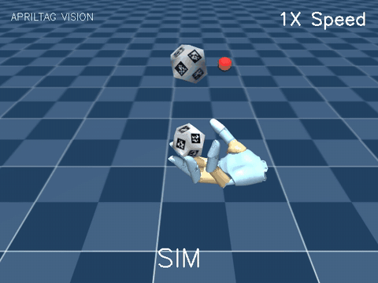
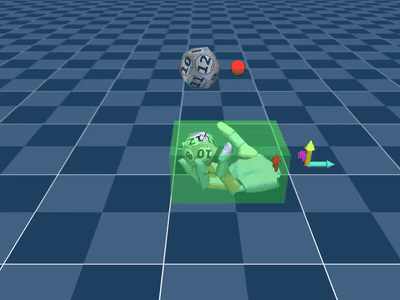
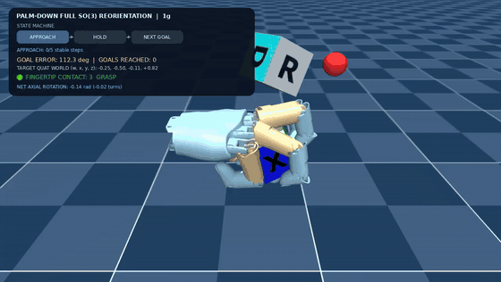
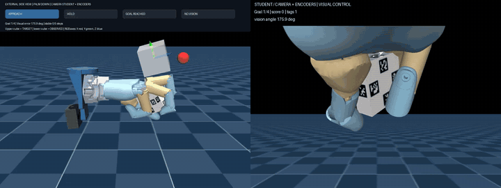

# Wuji Dexhand Reorient

**Wuji Hand 灵巧手手内重定向：掌心向上的十二面体 & 掌心向下的六面体（方块）**

[项目主页](https://johnny-lauhm.github.io/wuji-dexhand-reorient/) · [演示视频](#演示) · [结果](#结果) · [使用](#使用)

基于 [wuji-mjlab](https://github.com/wuji-technology/wuji-mjlab)（MuJoCo / mjlab + rsl_rl）。这个仓库收录两个任务：

- **十二面体，掌心向上**：在手掌上把十二面体连续转到随机目标朝向；物体位姿可以来自特权状态，也可以来自 AprilTag 视觉估计。
- **六面体（45 mm 方块），掌心向下**：手掌朝下，在重力作用下用指尖托住方块，转到任意 SO(3) 目标姿态；最后蒸馏成只用腕部 D405 相机和关节编码器的视觉学生策略。

> 下面所有结果都来自仿真，还没有在真实硬件上验证。

---

## 演示

点 GIF 打开完整视频（mp4）。

### 十二面体 · 掌心向上 · 状态机

<table>
<tr>
<td width="50%"><a href="demos/dodecahedron/apriltag_teacher_status_demo.mp4"></a></td>
<td width="50%"><a href="demos/dodecahedron/teacher_numbered_demo.mp4"></a></td>
</tr>
<tr>
<td><b>AprilTag 视觉驱动 + 状态机</b><br>RGB → AprilTag 36h11 → 标签板 PnP → 冻结的 teacher。上方小球是状态灯：<b>红</b>=还没到达目标，<b>绿</b>=已进入成功阈值，之后切换到下一个目标。</td>
<td><b>特权 teacher · 带编号十二面体</b><br>30 秒内到达 16 个目标，0 次掉落。</td>
</tr>
</table>

### 六面体 · 掌心向下 · 状态机

<a href="demos/palm_down/palm_down_anypose_state_machine.mp4"></a>

**任意 SO(3) 姿态 · 状态机**：`APPROACH → HOLD → NEXT GOAL`。HUD 显示目标误差、已完成目标数、指尖接触；上方的半透明方块是目标姿态。

### 六面体 · 掌心向下 · 腕部相机视觉学生

<a href="demos/visual_student/student_dual_view.mp4"></a>

左边是外部视角（目标和当前姿态坐标轴、视觉状态机），右边是腕部 D405 相机画面。策略的输入只有视觉估计的方块位姿、关节角、目标和动作历史，没有任何物体真值。32 秒里 4 个目标全部完成。

<details>
<summary><b>更多视频</b></summary>

| 视频 | 说明 |
|---|---|
| [teacher_final_demo.mp4](demos/dodecahedron/teacher_final_demo.mp4) | 十二面体 teacher，30 秒 |
| [teacher_ckpt3900_rotation_20s.mp4](demos/dodecahedron/teacher_ckpt3900_rotation_20s.mp4) | 十二面体，训练中期 checkpoint（第 3900 轮） |
| [apriltag_ppo_unconverged_demo.mp4](demos/dodecahedron/apriltag_ppo_unconverged_demo.mp4) | 负结果：直接用视觉观测训练 PPO，没有收敛 |
| [palm_down_spin.mp4](demos/palm_down/palm_down_spin.mp4) / [continuous_contact_spin.mp4](demos/palm_down/continuous_contact_spin.mp4) | 掌心向下旋转 / 加强接触奖励的版本 |
| [teacher_30s_rollout.mp4](demos/palm_down/teacher_30s_rollout.mp4) | 掌心向下 teacher，30 秒 rollout |
| [camera_closed_loop.mp4](demos/visual_student/camera_closed_loop_factory_vga.mp4) | 视觉学生相机闭环（出厂 VGA，90.6%） |
| [integrated_external_view.mp4](demos/visual_student/integrated_external_view.mp4) / [integrated_wrist_view.mp4](demos/visual_student/integrated_wrist_view.mp4) | 法兰 + 手 + D405 集成环境，外部视角 / 腕部视角 |
| [AprilTag tracking](demos/visual_student/wrist_tracking_apriltag.mp4) / [ArUco tracking](demos/visual_student/wrist_tracking_aruco.mp4) | 腕部相机标签跟踪对比 |

</details>

---

## 结果

### 六面体 · 掌心向下 · Teacher（413 维特权状态）

评估设置：64 个环境 × 3 个种子，每条 30 秒；每个目标要在 8 秒内进入 0.2 rad 并连续保持 5 步。

| 指标 | 结果 |
|---|---|
| 8 秒内到达目标 | **96.16%**（2682 / 2789） |
| 初始误差 120–180° 的难目标 | 95.62%（1636 / 1711） |
| 30 秒存活 | 99.48%（191 / 192） |
| 每分钟完成目标数 | 28.4（旧模型 19.1） |

### 六面体 · 掌心向下 · 视觉学生（207 维：腕部相机 + 编码器）

评估设置：16 条 × 32 秒，每 8 秒换一个完整 SO(3) 目标。

| 学生 / 相机配置 | 目标成功 | 成功率 | 存活率 |
|---|---:|---:|---:|
| DAgger · 出厂 VGA 内参 | 58 / 64 | **90.6%** | 93.8% |
| DAgger · 出厂广角 | 53 / 64 | 82.8% | 81.3% |
| DAgger · 标称广角 | 50 / 64 | 78.1% | 93.8% |
| BC 初始化 | 48 / 64 | 75.0% | 81.3% |

### 十二面体 · 掌心向上

| 配置 | 结果 |
|---|---|
| 特权 teacher，30 秒 | 到达 16 个目标，0 次终止 |
| RGB → AprilTag → 冻结 teacher（16 个环境） | 首个目标 **16 / 16**，平均 1.34 秒；有新鲜检测的帧占 97.7% |
| 域随机化微调后 + AprilTag | 每条轨迹平均 11.4 个目标，15 / 16 存活 |
| 负结果：直接用 AprilTag 观测训练 PPO（约 5000 轮） | 首个目标 0 / 16，没有收敛 |

---

## 方法概览

```
十二面体（掌心向上）
  特权状态 ──PPO──▶ teacher
  渲染 RGB → AprilTag 36h11 → 标签板 PnP → 物体位姿 ──▶ 冻结的 teacher

六面体（掌心向下）
  稳定抓握 → 小角度目标 → 大角度目标 → 完整 SO(3)   （课程式 PPO，413 维特权 teacher）
  腕部 D405 RGB → AprilTag + PnP + 跳变过滤 → 方块位姿 ┐
  关节编码器 / 目标 / 动作历史 ─────────────────────────┴─▶ 207 维学生（BC → DAgger）
```

掌心向下的状态机：`APPROACH`，姿态误差小于 0.2 rad 并连续保持 5 步 → `HOLD`（约 1 秒的成功窗口）→ 采样下一个目标。

---

## 仓库结构

```
src/wuji_mjlab/
  tasks/dodecahedron/        十二面体任务（env_cfg、L515 相机、AprilTag 位姿）
  tasks/reorient/            重定向任务；downward_grasp.py 是掌心向下的部分
  perception/                apriltag.py、batch_apriltag.py、cube_wrist.py
  assets/objects/dodecahedron/        十二面体模型和 AprilTag 贴图
  assets/robots/wuji_hand/            wrist_assembly.xml（法兰 + 手 + D405）
src/wuji_rl_libs/rsl_rl/     修改过的 distillation 和 cnn_model
scripts/train/               train_dodecahedron_*、train_apriltag_pose、train_l515*、
                             train_cube_downward*、train_cube_wrist_student、train_cube_wrist_dagger
scripts/                     eval_*、record_cube_downward_demo、生成和校验 AprilTag 的工具
deploy/wrist_student/        视觉学生发布检查
hardware/                    45 mm 方块 STL、标签贴纸
demos/                       演示视频
docs/                        实现文档
index.html, site/            项目主页（GitHub Pages）
```

## 使用

这个仓库的目录结构和 wuji-mjlab 一致，覆盖到框架根目录就能用。**必须使用 wuji-mjlab 的 `9410a3a` 版本**，上游之后的版本改过 rsl_rl 和手部资产的结构，直接覆盖会报错。

```bash
git clone https://github.com/wuji-technology/wuji-mjlab.git
git -C wuji-mjlab checkout 9410a3a
git clone https://github.com/Johnny-lauHM/wuji-dexhand-reorient.git
rsync -a --exclude .git --exclude README.md --exclude index.html --exclude site --exclude demos \
  wuji-dexhand-reorient/ wuji-mjlab/
cd wuji-mjlab && pixi install

# 自检：任务测试全部通过即说明环境正确
pixi run pytest -q src/wuji_mjlab/tasks/dodecahedron/tests src/wuji_mjlab/tasks/reorient/tests
```

```bash
# 十二面体
pixi run train --task WujiHand_Dodecahedron
pixi run python scripts/train/train_apriltag_pose.py --smoke
pixi run python scripts/eval_apriltag_teacher.py

# 六面体 · 掌心向下：teacher → 视觉学生
pixi run python scripts/train/train_cube_downward.py --phase hold --smoke   # 快速检查
pixi run python scripts/train/train_cube_downward_any_pose.py
pixi run python scripts/train/train_cube_wrist_student.py
pixi run python scripts/train/train_cube_wrist_dagger.py
pixi run python scripts/eval_cube_wrist_student.py

# 录制状态机演示视频
MUJOCO_GL=egl pixi run python scripts/record_cube_downward_demo.py --seconds 12 --output demo.mp4
```

详细文档：
- [掌心向下任意姿态实现](docs/PALM_DOWN_ANY_POSE_IMPLEMENTATION.zh-CN.md)
- [L515 / AprilTag 训练](docs/L515_APRILTAG_TRAINING.zh-CN.md)
- [十二面体任务说明](src/wuji_mjlab/tasks/dodecahedron/README_zh.md)

训练日志和 checkpoint（`*.pt`）没有放进仓库，评估和录视频之前需要先自己训练。

## 硬件

- [45 mm 空心方块 STL](hardware/palm_down_cube_45mm/cube45_hollow_body_wall1p6mm.stl) + [盖子](hardware/palm_down_cube_45mm/cube45_lid_1p6mm.stl) + [各面贴纸 A4](hardware/palm_down_cube_45mm/cube45_face_stickers_A4.pdf)
- [腕部 AprilTag（48 mm）](hardware/palm_down_cube_45mm/wrist_apriltag36h11_ID0_48mm_A4.pdf)
- [十二面体 AprilTag 打印稿](src/wuji_mjlab/assets/objects/dodecahedron/apriltag_print_A4.svg)

## License

Apache-2.0，见 [LICENSE](LICENSE) 和 [NOTICE](NOTICE)。框架来自 wuji-mjlab（© Wuji Technology），内置的 rsl_rl 是 BSD-3-Clause。
