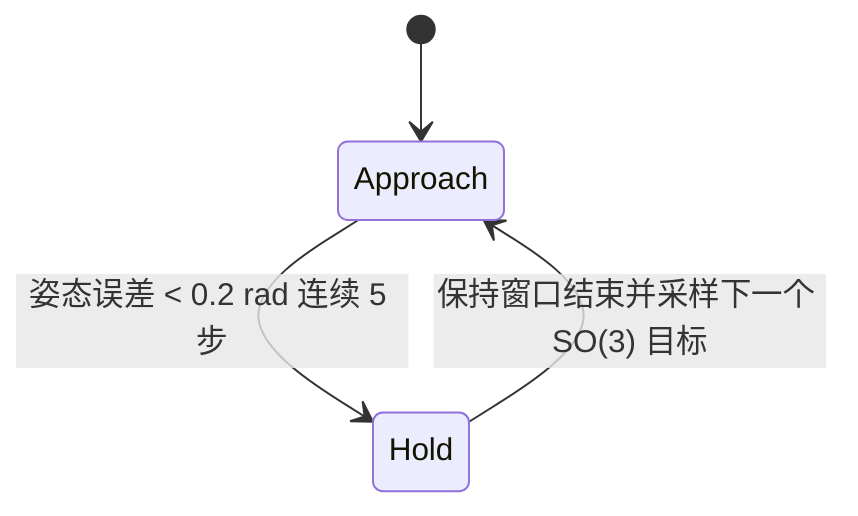

# 掌心向下方块任意姿态重定向

本文记录当前掌心向下（palm-down）方块全姿态重定向的环境、奖励、状态机、训练流程、评估结果和关键产物。

## 任务定义

- Wuji Hand 固定在掌心向下姿态，手腕不参与动作；策略控制手指关节，在 1g 重力下用指尖托住方块。
- 物体为边长 45 mm 的方块，按原方块密度同比缩放后约 69 g。缩小方块是为了降低倒置抓持时的负载。
- 每个目标是一个完整的 SO(3) 方位四元数，按腕部 tag 坐标语义采样，再变换到仿真世界坐标。每次到达目标后切换到新的随机姿态。
- 这表示连续的随机目标重定向任务。它不等同于沿固定轴以恒定速度持续翻转。
- 当前策略输入是 413 维特权仿真状态。此 teacher 尚未改为相机图像或 AprilTag 位姿输入，也没有执行视觉蒸馏。

手掌朝下由机器人根姿态固定实现：绕 Y 轴旋转 +90°，使局部抓持方向 +X 朝向世界 -Z。目标奖励只约束方块相对于目标的姿态；手腕不在动作空间里，因此不需要另加一个“掌心朝下”策略奖励。

## 控制和成功状态机

策略控制步长为 50 ms（物理步长 10 ms，每次策略动作执行 5 个物理步）。状态机如下：



`APPROACH` 中，方块必须进入 0.2 rad（约 11.5°）阈值并连续保持 5 个策略步才算到达。到达后进入 `SUCCESS_WINDOW`，最多约 1 秒后切换目标。演示 HUD 将切换事件额外显示 0.5 秒，便于观看；这段显示时间不改变策略状态机。

评估还加了 8 秒目标时限：目标在开始后的 8 秒内触发成功事件才记作限时成功。训练环境本身不使用这个 8 秒时限作为终止条件。

## Reward 组成

旋转阶段的 reward 项在 `scripts/train/train_cube_downward.py::make_cfg` 配置，单位按每个策略步的 `step_dt` 缩放：

| 项 | 权重 | 用途 |
|---|---:|---|
| `orientation_alignment` | +40 | 基于四元数测地误差的连续姿态接近奖励；0.2 rad 内为满值，误差增大时线性衰减 |
| `directed_rotation` | +5 | 将世界角速度投影到当前最短姿态误差轴，鼓励沿缩短误差的方向转动 |
| `hold_escalation` | +25 | 到达后，仅在成功窗口且仍处于姿态阈值内时逐步增加保持奖励 |
| `cage_escape` | -750 | 方块离开掌内安全区域的惩罚；超过 14 个步长的 cage 越界会终止 episode |
| `torque` | -24 | 惩罚高扭矩 |
| `action_rate` | -0.2 | 惩罚动作变化 |
| `tip_slide` | -0.3 | 惩罚指尖接触时的相对滑动 |
| `finger_collision` | -1 | 惩罚手指互撞 |
| `hand_pose` | -0.2 | 限制手型偏离默认关节姿态 |
| `center` | +0.5 | 保持方块处于掌内目标中心附近 |
| `fingertip_contact` | +0.5 | 鼓励维持指尖接触 |
| `alive` | +2 | 存活奖励 |

已修复目标切换最后一帧的保持奖励时序：状态机现在把切换前的成功窗口状态和保持计数保存为 reward snapshot，`hold_escalation` 使用该 snapshot，避免 goal switch 清零状态后丢失最后一帧奖励。

训练配置保留重置事件，关闭训练期的质量、摩擦、驱动参数随机化与外部扰动。因此本次结果是标称物理参数下的掌心向下 teacher 结果，不代表已经验证 sim-to-real 鲁棒性。

## 训练流程

方块从官方默认 54 mm 缩至 45 mm，腕部姿态固定为掌心向下。全姿态目标直接从完整 SO(3) 采样；不通过逐步缩小目标角度来定义最终任务。

首次训练从稳定抓握 checkpoint 开始：

1. 300 轮保持抓握适配。
2. 500 轮目标旋转，目标角最大 0.8 rad。
3. 1000 轮目标旋转，目标角最大 1.6 rad。
4. 3500 轮完整 SO(3) 目标旋转。

之后修复了保持奖励 snapshot，并从首轮完整 SO(3) 模型继续训练 8000 轮，使用 2048 个并行环境、随机种子 1084。保存的最终模型继续以任意姿态目标为训练目标。

## 验收结果

评估使用特权状态 actor、45 mm 方块、64 个并行环境、每条轨迹 30 秒，按三个独立随机种子评估；每个目标的限时成功窗口为 8 秒。

- 续训模型三种子合计 192 条轨迹中 191 条存活到 30 秒结束，存活率 99.48%。
- 2789 次目标尝试中 2682 次在 8 秒内完成，合并成功率 96.16%。
- 初始姿态误差 120–180° 的目标有 1636/1711 次在 8 秒内完成，成功率 95.62%。
- 指尖接触率为 100%。
- 在与旧模型相同的 seed 2084 上，8 秒目标成功率从 93.25% 提升至 97.01%；平均每分钟目标数从 19.06 提升至 28.41。

这些数据验证随机目标到达和短暂保持，不验证持续固定轴旋转，也不验证真实相机闭环。

## 演示

状态机视频在 MuJoCo 仿真图像上显示：

- `APPROACH`、`HOLD`、`NEXT GOAL` 三阶段及阶段进度；
- 当前姿态误差、已完成目标数、目标四元数；
- 实物上方 10 cm 的半透明目标姿态方块；
- 与目标是否在 0.2 rad 内对应的红/绿状态球，以及指尖接触灯。

当前录制视频为 12 秒、1280×720、20 fps。演示用种子 444；回放中指尖接触率约 97.1%。单段回放有随机接触动力学波动，不作为多 seed 验收统计。

## 关键文件与复现入口

- 主环境和掌心朝下姿态：[env_cfgs.py](../src/wuji_mjlab/tasks/reorient/config/wuji_hand/env_cfgs.py)
- 目标采样与状态机：[commands.py](../src/wuji_mjlab/tasks/reorient/mdp/commands.py)
- reward 项：[rewards.py](../src/wuji_mjlab/tasks/reorient/mdp/rewards.py)、[train_cube_downward.py](../scripts/train/train_cube_downward.py)
- 长课程脚本：[train_cube_downward_any_pose.py](../scripts/train/train_cube_downward_any_pose.py)
- 多目标评估：[eval_cube_downward.py](../scripts/eval_cube_downward.py)
- 官方风格录像：[record_cube_downward_demo.py](../scripts/record_cube_downward_demo.py)
- 最新模型：`logs/rsl_rl/wuji_cube_downward/anypose_rewardfix_20260923_v1/rotate_full_so3_8000/final.pt`
- 评估汇总：`logs/rsl_rl/wuji_cube_downward/anypose_rewardfix_20260923_v1/comparison_summary.json`
- 状态机视频：`logs/rsl_rl/wuji_cube_downward/demo_annotated_20260923/palm_down_anypose_state_machine.mp4`

续训命令示例：

```bash
.pixi/envs/default/bin/python scripts/train/train_cube_downward.py \
  --phase rotate \
  --resume logs/rsl_rl/wuji_cube_downward/anypose_rewardfix_20260923_v1/rotate_full_so3_8000/final.pt \
  --num-envs 2048 --iterations 8000 --seed 1084 --cube-edge-m 0.045 \
  --output logs/rsl_rl/wuji_cube_downward/next_run
```

评估命令示例：

```bash
.pixi/envs/default/bin/python scripts/eval_cube_downward.py \
  --checkpoint logs/rsl_rl/wuji_cube_downward/anypose_rewardfix_20260923_v1/rotate_full_so3_8000/final.pt \
  --phase rotate --num-envs 64 --seconds 30 --goal-deadline-s 8 \
  --seed 5084 --cube-edge-m 0.045 \
  --output logs/rsl_rl/wuji_cube_downward/eval_seed_5084
```

## 产物保留与空间清理

清理范围为 `logs/rsl_rl/wuji_cube_downward`：保留所有 `final.pt`、JSON/配置/代码明确引用的模型快照、官方 release checkpoint，以及独立的连续 spin 演示；删除未被引用的逐轮 checkpoint、TensorBoard event 缓存和被状态机版 demo 替代的旧录像。具体删除数量与回收字节数记录在 `logs/rsl_rl/wuji_cube_downward/cleanup_manifest.json`。评估 JSON、manifest、训练配置和纯文本训练日志保留用于追溯。
